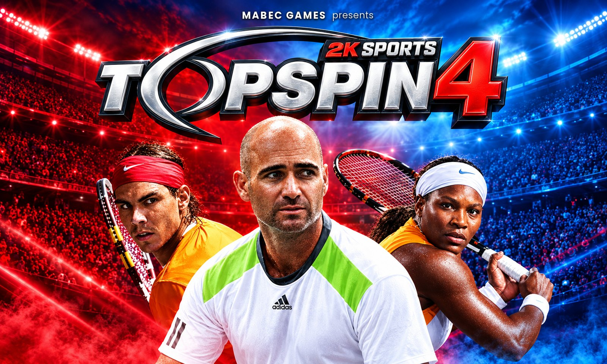
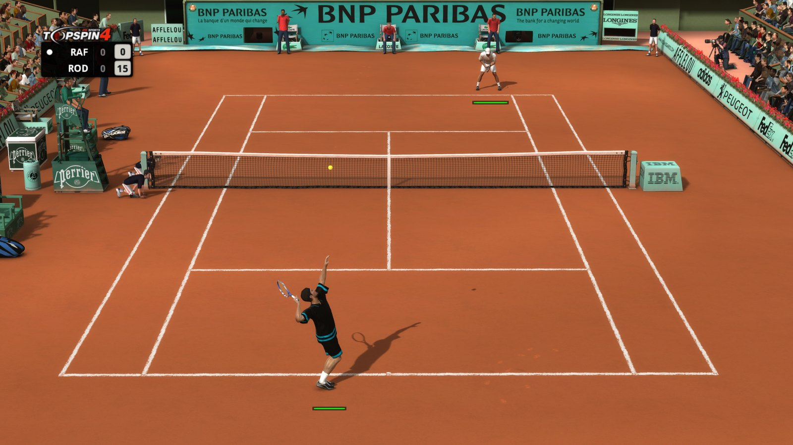
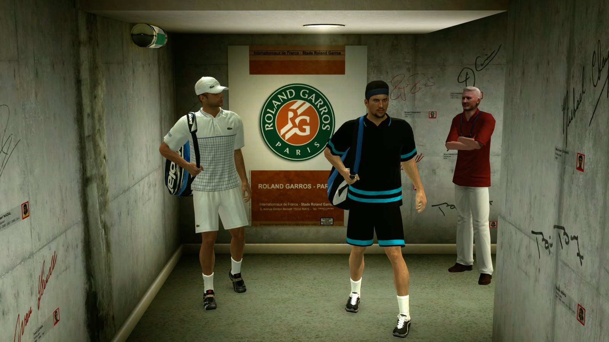
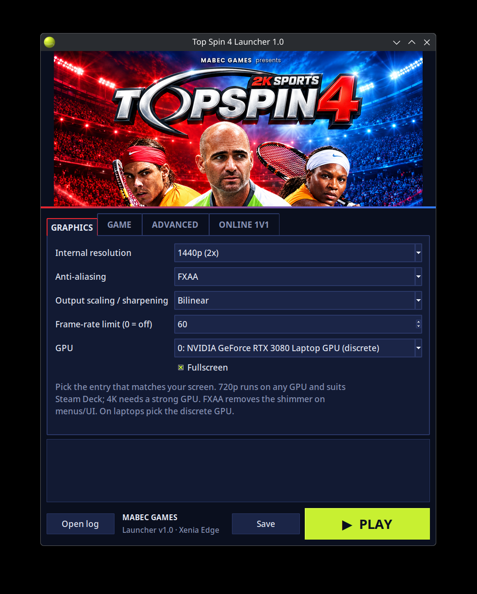

<p align="center">
  
</p>

# Top Spin 4 Launcher

**Play the Xbox 360 version of Top Spin 4 on PC: one download, with the emulator built in.**

> [!WARNING]
> **Early version (v1.0).** So far it has only been tested and confirmed working on **Linux**.
> The Windows build is compiled and smoke-tested automatically on GitHub Actions
> (see [Windows smoke test](#windows-smoke-test)), but nobody has played on Windows yet.

The launcher is built on **[Xenia Edge](https://github.com/has207/xenia-edge)**, a fork of the
Xenia Xbox 360 emulator. Xenia Edge is bundled inside the launcher, so players don't download
anything else. You only need **your own copy of Top Spin 4** (Xbox 360 disc image, title ID
`54540859`); no game files are included.

## Screenshots

| In a match | Roland Garros tunnel |
|---|---|
|  |  |

<p align="center"></p>

## Test status

| Platform | Status |
|---|---|
| Linux (AppImage) | ✅ Tested and confirmed: boot, "Press Start", menus and matches at 720p, 1440p and 4K (CachyOS, NVIDIA RTX 3080 Laptop, KDE Wayland) |
| Windows (.zip) | 🧪 Builds and passes automated smoke tests on GitHub Actions; not yet played |
| Steam Deck | ❔ Untested (AppImage bundles its own glibc and has 800p presets) |
| Steam Remote Play Together | ❔ Untested with two devices |

## Features

- **Xenia Edge built in**, pinned to a tested build (`1574493`).
- **Fix for the "Press Start" freeze.** Right after Start, two game threads spin-wait on each other
  and Xenia Edge's cooperative scheduler never runs the thread they need. The launcher enables Edge's
  starvation workaround (`guest_scheduler_spin_quanta=1`, `guest_scheduler_quantum_us=250`). In
  automated Start-press trials this went from 1 in 4 successful boots to 26 of 26 across 720p, 1440p and 4K.
- **No profile prompts.** On first run the launcher asks for a gamertag and creates a proper Xbox 360
  profile, so Xenia's "No Profiles Found" box and the game's sign-in prompt never appear.
  Broken profiles (which make the game hang) are quarantined automatically.
- **Resolutions:** 720p, 1080p (rendered at 2x and scaled down), 1440p, 4K and Steam Deck 800p, plus FXAA
  and AMD FSR/CAS scaling.
- **GPU picker with real names** (Vulkan; Direct3D 12 or Vulkan on Windows).
- **Portable:** settings, profiles, saves and shader cache live in a `data/` folder next to the launcher
  (inside the unzipped folder on Windows).
- **Steam integration:** "Add to Steam" creates a library entry with artwork, ready for
  Remote Play Together. Steam Input's duplicate virtual pad is filtered out when the game is started outside Steam.
- **Linux AppImage** that bundles Python, Tk and glibc, so it doesn't depend on your distro's libraries.

## Getting started

1. **Linux:** put the `.AppImage` in a folder of its own.
   **Windows:** unzip `Top-Spin-4-Launcher-Windows-…-x64.zip` and open `TopSpin4Launcher.exe` in the unzipped folder.
2. Start it, enter a gamertag, and on the **Game** tab pick your Top Spin 4 disc image (`.iso`)
   if it isn't found automatically next to the launcher.
3. Choose a resolution that matches your screen and press **PLAY**.

Command line: `--play` starts the game directly with the saved settings (used by the Steam shortcut),
`--dry-run` prints the Xenia command line, and `--self-test` runs a headless check.

## Known issues

- **Escape opens Xenia's overlay menu.** This is hard-coded in Xenia Edge; press Escape again to close it.
  (The Guide button and right-click menu are turned off by the launcher.)
- After pressing Start, loading occasionally pauses for 10–30 seconds before it continues.
- Online play used Xbox LIVE, which is shut down, and the game has no System Link mode. For 1v1 online,
  stream local multiplayer instead (Steam Remote Play Together, Parsec, or Sunshine + Moonlight).
- Keep the frame-rate limit at 60: higher values speed up the game.

## Building

The release files are built locally and are not stored in this repository.

```sh
# Linux AppImage (needs appimagetool + its type-2 runtime, and the Xenia Edge AppImage)
python3 tools/build_appimage.py --appimagetool PATH --runtime PATH --xenia PATH/xenia_edge_linux.appimage

# Windows zip (on Windows; put the Xenia Edge Windows build in xenia\windows\ first)
tools\build_windows.cmd
```

`tools/make_assets.py` regenerates the icon, header and Steam artwork in `assets/`.

### Windows smoke test

[`.github/workflows/smoke-test.yml`](.github/workflows/smoke-test.yml) runs on every push:

- **Windows:** downloads the pinned Xenia Edge Windows build (SHA-256 verified), builds the release
  zip with PyInstaller, unzips it into an empty folder like a player would, and checks that:
  - the self-test passes,
  - the bundled Xenia is found,
  - the Direct3D 12 GPU detection runs,
  - the bundled `xenia_edge.exe` starts.
- **Linux:** the same self-test, dry-run and Steam shortcut file round-trip.

No build output is uploaded.

## Credits and licenses

- **Xenia Edge** by has207 and contributors, based on Xenia by Ben Vanik and the Xenia team.
  BSD 3-Clause License, see [`licenses/XENIA_EDGE_LICENSE.txt`](licenses/XENIA_EDGE_LICENSE.txt).
- Launcher, packaging and artwork by **Mabec Games**.

*Top Spin 4 is a trademark of Take-Two Interactive / 2K Sports. This project is not affiliated
with or endorsed by 2K, Take-Two, Microsoft or the Xenia project, and it includes no game files.*
